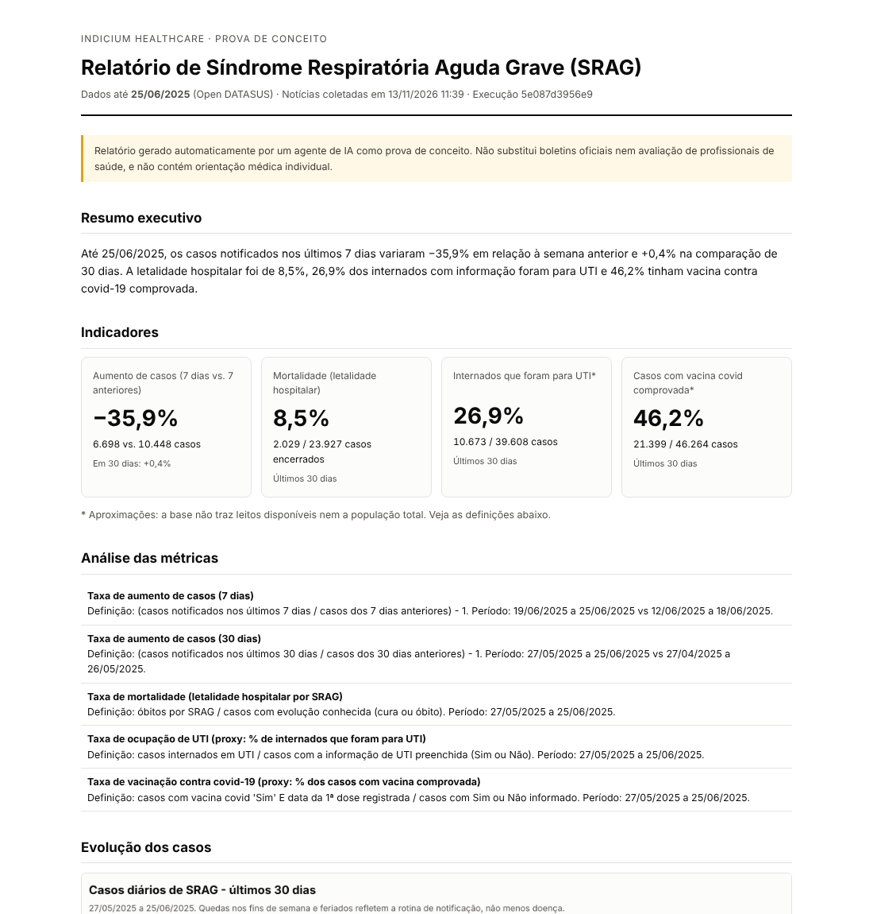
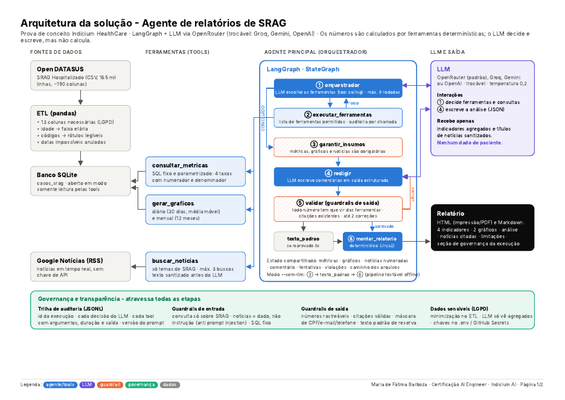

# Agente de relatórios de SRAG

**Certificação AI Engineer · Indicium AI** — Maria de Fátima Barboza

Prova de conceito para a Indicium HealthCare: um **agente de IA** que consulta a base de internações por
Síndrome Respiratória Aguda Grave (Open DATASUS), busca notícias em tempo real e gera um relatório com
métricas, gráficos e uma análise que explica o cenário.

> **Princípio da solução:** o LLM decide e escreve, mas **não calcula**. Todo número do relatório vem de
> ferramentas determinísticas e auditáveis; o texto do LLM só entra no relatório depois de passar pelos
> guardrails.



## Sumário

1. [O que o relatório entrega](#1-o-que-o-relatório-entrega)
2. [Arquitetura](#2-arquitetura)
3. [Como executar](#3-como-executar)
4. [Decisões sobre os dados e as métricas](#4-decisões-sobre-os-dados-e-as-métricas)
5. [Governança e transparência](#5-governança-e-transparência)
6. [Guardrails](#6-guardrails)
7. [Dados sensíveis (LGPD)](#7-dados-sensíveis-lgpd)
8. [Qualidade de código](#8-qualidade-de-código)
9. [Estrutura do repositório](#9-estrutura-do-repositório)
10. [Limitações e próximos passos](#10-limitações-e-próximos-passos)

---

## 1. O que o relatório entrega

| Item pedido | Como aparece |
|---|---|
| Taxa de aumento de casos | últimos 7 dias vs. 7 anteriores (e 30 vs. 30) |
| Taxa de mortalidade | letalidade hospitalar: óbitos por SRAG ÷ casos encerrados |
| Taxa de ocupação de UTI | aproximação: % dos internados que foram para UTI* |
| Taxa de vacinação | aproximação: % dos casos com vacina covid comprovada* |
| Gráfico diário (30 dias) | colunas por dia + média móvel de 7 dias, com feriado marcado |
| Gráfico mensal (12 meses) | colunas por mês, meses parciais hachurados e meses fora do arquivo indicados |
| Explicação do cenário | análise escrita pelo LLM, ligando métricas e notícias, com citações [n] |

\* A base não traz leitos disponíveis nem a população total; a justificativa está na
[seção 4](#4-decisões-sobre-os-dados-e-as-métricas).

Cada métrica sai com **valor, numerador, denominador, período e definição**, e o relatório tem uma tabela
"Definições e números de origem", para que qualquer pessoa possa refazer a conta.

**Exemplo gerado:** [`docs/exemplo_relatorio/`](docs/exemplo_relatorio/) (HTML, Markdown, gráficos e a trilha de
auditoria da execução).

## 2. Arquitetura

📄 **Diagrama conceitual (PDF):** [`docs/arquitetura_solucao.pdf`](docs/arquitetura_solucao.pdf)



O agente é um **grafo de estados em LangGraph**:

| Nó | Quem decide | O que faz |
|---|---|---|
| ① `orquestrador` | LLM (tool calling) | escolhe as ferramentas e formula as buscas de notícias |
| ② `executar_ferramentas` | código | executa só ferramentas permitidas e registra cada chamada |
| ③ `garantir_insumos` | código (guardrail) | garante métricas, gráficos e notícias mesmo que o LLM esqueça |
| ④ `redigir` | LLM (saída estruturada) | escreve resumo, análise por métrica, contexto e pontos de atenção |
| ⑤ validação | código (guardrail) | confere números e citações; devolve ao LLM para correção (até 2x) |
| `texto_padrao` | código | texto determinístico de reserva se o LLM for reprovado 3 vezes |
| ⑥ `montar_relatorio` | código | monta HTML e Markdown com Jinja2 |

**Ferramentas (tools):**

| Tool | Faz | Controle |
|---|---|---|
| `consultar_metricas` | calcula as 4 taxas no SQLite | SQL fixo e parametrizado, conexão somente leitura |
| `gerar_graficos` | gera os 2 gráficos (matplotlib) | lê do mesmo banco das métricas |
| `buscar_noticias` | busca no Google Notícias (RSS) | só temas de SRAG, máx. 3 buscas, texto sanitizado |

**Por que essa arquitetura**

- **Grafo explícito em vez de agente "livre":** o LLM tem autonomia onde ela agrega valor (escolher buscas e
  interpretar), e o fluxo crítico (insumos obrigatórios, validação, montagem) é determinístico e testável.
- **Separar cálculo de redação** elimina a principal fonte de erro de LLMs em relatórios: números inventados.
- **LLM trocável:** OpenRouter por padrão (chave gratuita, sem cartão; o roteador `openrouter/free` escolhe um
  modelo gratuito com suporte a tool calling e saída estruturada). Groq, Gemini ou OpenAI com uma linha no `.env`.
  O modelo que efetivamente respondeu fica registrado na trilha de auditoria.
- **Google Notícias via RSS:** dispensa cadastro e chave, então qualquer pessoa consegue reproduzir o projeto.
- **SQLite:** o desafio pede um banco consultado pelo agente; o SQLite não exige servidor e permite abrir a
  conexão em modo somente leitura.

## 3. Como executar

### Opção A — no GitHub, sem instalar nada (recomendado)

1. Em **Settings → Secrets and variables → Actions**, crie o secret `OPENROUTER_API_KEY` (chave gratuita, sem
   cartão, em [openrouter.ai/keys](https://openrouter.ai/keys)). Também funciona com `GROQ_API_KEY`,
   `GOOGLE_API_KEY` ou `OPENAI_API_KEY`: o provedor é detectado pela chave cadastrada.
2. Em **Actions → Gerar relatório SRAG → Run workflow**.
3. O relatório fica disponível como artefato da execução e é publicado em `docs/exemplo_relatorio/`.

O mesmo workflow roda sozinho toda segunda-feira às 8h (Brasília). O workflow **Qualidade** roda lint e
testes a cada push.

### Opção B — no computador

Requer Python 3.11+.

```bash
git clone https://github.com/<usuario>/<repositorio>.git
cd <repositorio>
python -m venv .venv
# Windows: .venv\Scripts\activate   |   Linux/Mac: source .venv/bin/activate
pip install -r requirements-dev.txt

cp .env.example .env        # e preencha OPENROUTER_API_KEY
python -m srag_agent        # com LLM
python -m srag_agent --sem-llm   # sem LLM, para testar o pipeline
pytest -q                   # testes
```

> Se o pacote não for encontrado, rode com `PYTHONPATH=src` (Linux/Mac) ou `set PYTHONPATH=src` (Windows),
> ou instale com `pip install -e .`.

Saídas: `outputs/relatorio_srag.html` (abre no navegador; para PDF, use Imprimir → Salvar como PDF),
`outputs/relatorio_srag.md` e a trilha em `logs/execucao_<data>_<id>.jsonl`.

Os dados brutos já estão no repositório (`data/raw/*.zip`, 19 MB); o ETL roda sozinho na primeira execução.

## 4. Decisões sobre os dados e as métricas

A análise completa, com números, está em [`docs/analise_dos_dados.md`](docs/analise_dos_dados.md). Em resumo:

- **O arquivo cobre de 29/12/2024 a 26/06/2025** (cerca de 6 meses). O gráfico de 12 meses mostra os meses
  anteriores como "fora do arquivo", em vez de barras zeradas que sugeririam "zero casos".
- **A data de referência é 25/06/2025:** o dia 26/06 é o dia da extração e tem só 3 registros.
- **As contagens usam a data de notificação**, e não a de 1º sintomas. Pela data de sintomas, os últimos 7 dias
  caem 64,8% frente aos 7 anteriores (contra 35,9% pela notificação), efeito do atraso de notificação.
- **Mortalidade** = óbitos por SRAG ÷ casos encerrados (cura ou óbito); casos em aberto (22,7%) ficam fora.
- **Vacinação:** o campo `VACINA_COV` marca como vacinados 24.575 bebês com menos de 1 ano, e só 25,6% dos
  "Sim" têm a data da dose. Adotei um critério conservador: vacinado = "Sim" **e** 1ª dose registrada.
- **Janela de 30 dias** para mortalidade, UTI e vacinação: mostra o cenário atual, que é o objetivo do relatório.

**Gráficos:** a escolha de cada um foi pensada para não induzir a erro. O diário combina colunas claras (dado
bruto) com a linha da média móvel de 7 dias (tendência) em um eixo só, e marca o feriado. O mensal diferencia
mês completo, mês parcial (hachurado) e mês fora do arquivo. Todos têm números no padrão brasileiro e a fonte
no rodapé.

## 5. Governança e transparência

Cada execução gera um arquivo **JSONL de auditoria** (`logs/execucao_<data>_<id>.jsonl`), uma linha por
evento:

| Evento | Registra |
|---|---|
| `inicio_execucao` | provedor, modelo, temperatura e versão dos prompts |
| `decisao_llm` | ferramentas escolhidas e argumentos; na redação, hash do prompt e da entrada, aprovação e violações |
| `ferramenta` | nome, argumentos, duração, status e saída (resumida com hash, se for grande) |
| `guardrail` | regra que disparou e ação tomada |
| `decisao_sistema` / `erro_llm` | decisões automáticas e falhas do provedor |
| `montagem_relatorio` / `fim_execucao` | arquivos gerados e origem do texto (LLM ou padrão) |

Exemplo real: [`docs/exemplo_relatorio/trilha_auditoria.jsonl`](docs/exemplo_relatorio/trilha_auditoria.jsonl).

Outras medidas:
- **Prompts versionados** em `agente/prompts.py` (`VERSAO_PROMPTS`), registrados em cada execução.
- O próprio relatório traz uma seção **"Governança desta execução"**: origem do texto, modelo, versão dos
  prompts, ferramentas executadas, quantidade de eventos de guardrail e o nome do arquivo de log.
- Datas explícitas: "dados até" e "notícias coletadas em" aparecem separados no cabeçalho, porque a base vai
  até junho/2025 e as notícias são do dia da execução.

## 6. Guardrails

**Entrada**
- `buscar_noticias` só aceita consultas sobre SRAG e temas correlatos; outras são bloqueadas antes de acessar a
  rede.
- Notícias são tratadas como **dado, nunca como instrução**: HTML removido, tamanho limitado, frases típicas de
  prompt injection neutralizadas, conteúdo delimitado em `<noticias>` e uma regra explícita no prompt.
- O LLM não escreve SQL: a ferramenta de métricas não recebe parâmetros, e o banco abre em modo somente leitura.
- Lista de ferramentas permitidas, máximo de 6 rodadas do orquestrador e de 3 buscas.

**Saída**
- **Números rastreáveis:** todo número do texto é comparado com as saídas das ferramentas; na seção de
  notícias, também com os números dos títulos.
- **Citações válidas:** só pode citar `[n]` de notícias que a ferramenta trouxe.
- **Correção automática:** se algo for reprovado, o LLM recebe os motivos e reescreve (até 2 vezes); depois
  disso, entra o texto padrão determinístico, e o evento fica registrado.
- **Máscara de dados pessoais** (CPF, e-mail, telefone) em todo texto do relatório.
- **Escopo:** o prompt proíbe orientação médica individual, e o relatório traz aviso fixo.

## 7. Dados sensíveis (LGPD)

- **Minimização no ETL:** das 194 colunas, só 13 entram no banco. Data de nascimento, município, unidade de
  saúde, ocupação, textos livres e número da notificação ficam de fora; a idade vira faixa etária.
- **O LLM só recebe agregados** (taxas, contagens, títulos de notícias). Isso importa também porque planos
  gratuitos de LLM podem usar os dados enviados para melhorar os produtos do fornecedor.
- **Segredos fora do código:** `.env` está no `.gitignore`; na nuvem, a chave fica em GitHub Secrets.
- Um teste automatizado garante que colunas identificadoras não aparecem no banco.

## 8. Qualidade de código

- Pacote Python com responsabilidades separadas: `dados` (ETL), `ferramentas` (tools), `agente` (grafo, prompts,
  relatório) e `governanca` (auditoria e guardrails). O layout do relatório fica em templates Jinja2.
- Configuração centralizada (`config.py`, `.env`), type hints e docstrings explicando o **porquê** das decisões.
- **29 testes automatizados** (`pytest`), incluindo o fluxo do agente com um LLM roteirizado: ferramenta
  obrigatória esquecida, número inventado, correção, reserva, ferramenta proibida e busca fora do tema.
- `ruff` para lint e formatação, e **CI no GitHub Actions** a cada push.

## 9. Estrutura do repositório

```
├── data/raw/                     # CSV original compactado (Open DATASUS)
├── docs/
│   ├── arquitetura_solucao.pdf   # diagrama conceitual (entrega)
│   ├── analise_dos_dados.md      # exploração e decisões de tratamento
│   └── exemplo_relatorio/        # relatório gerado + trilha de auditoria
├── src/srag_agent/
│   ├── config.py
│   ├── __main__.py               # ponto de entrada: python -m srag_agent
│   ├── dados/etl.py              # leitura, tratamento, anonimização, SQLite
│   ├── ferramentas/              # metricas.py · graficos.py · noticias.py
│   ├── agente/                   # grafo.py · prompts.py · llm.py · relatorio.py · templates/
│   └── governanca/               # auditoria.py · guardrails.py
├── tests/                        # pytest
└── .github/workflows/            # qualidade.yml · relatorio.yml
```

## 10. Limitações e próximos passos

**Limitações**
- A base disponibilizada é um recorte de 6 meses; com o arquivo anual completo, o gráfico de 12 meses e as
  comparações ficam completos sem mudar o código.
- UTI e vacinação são aproximações (veja a seção 4).
- As notícias são do dia da execução, enquanto os dados vão até 25/06/2025; o relatório deixa isso explícito.
- O RSS traz título e veículo, não o texto completo das notícias.

**Próximos passos**
- Cruzar com o CNES (leitos de UTI) e com o SI-PNI (vacinação) para trocar as aproximações por taxas reais.
- Corrigir o atraso de notificação com *nowcasting*, como faz o InfoGripe/Fiocruz.
- Adicionar um RAG sobre boletins oficiais (InfoGripe, Ministério da Saúde) para enriquecer o contexto.
- Observabilidade com LangSmith ou OpenTelemetry e avaliação contínua da qualidade do texto.
- Recortes por UF e faixa etária (os campos já estão no banco).

---

Fonte dos dados: [Open DATASUS – SRAG](https://opendatasus.saude.gov.br/) (SIVEP-Gripe). Projeto acadêmico,
sem fins clínicos.
