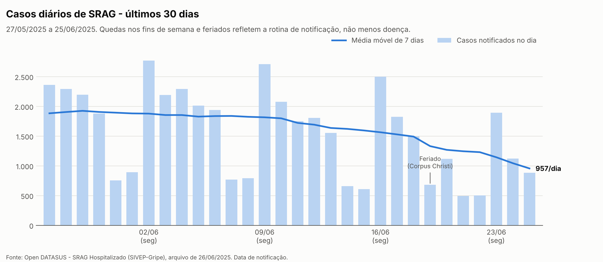

# Relatório de SRAG

Dados até **25/06/2025** · gerado em 13/11/2026 11:41 · execução `604147ac28bb`

> Relatório gerado automaticamente por um agente de IA como prova de conceito. Não substitui boletins oficiais nem avaliação de profissionais de saúde, e não contém orientação médica individual.

## Resumo executivo

Até 25/06/2025, os casos notificados nos últimos 7 dias variaram −35,9% em relação à semana anterior e +0,4% na comparação de 30 dias. A letalidade hospitalar foi de 8,5%, 26,9% dos internados com informação foram para UTI e 46,2% tinham vacina contra covid-19 comprovada.

## Métricas

| Métrica | Valor | Numerador | Denominador |
|---|---:|---:|---:|
| Taxa de aumento de casos (7 dias) | −35,9% | 6.698 | 10.448 |
| Taxa de aumento de casos (30 dias) | +0,4% | 46.845 | 46.678 |
| Taxa de mortalidade (letalidade hospitalar por SRAG) | 8,5% | 2.029 | 23.927 |
| Taxa de ocupação de UTI (proxy: % de internados que foram para UTI) | 26,9% | 10.673 | 39.608 |
| Taxa de vacinação contra covid-19 (proxy: % dos casos com vacina comprovada) | 46,2% | 21.399 | 46.264 |
## Análise

- **Taxa de aumento de casos (7 dias)**: Definição: (casos notificados nos últimos 7 dias / casos dos 7 dias anteriores) - 1. Período: 19/06/2025 a 25/06/2025 vs 12/06/2025 a 18/06/2025.
- **Taxa de aumento de casos (30 dias)**: Definição: (casos notificados nos últimos 30 dias / casos dos 30 dias anteriores) - 1. Período: 27/05/2025 a 25/06/2025 vs 27/04/2025 a 26/05/2025.
- **Taxa de mortalidade (letalidade hospitalar por SRAG)**: Definição: óbitos por SRAG / casos com evolução conhecida (cura ou óbito). Período: 27/05/2025 a 25/06/2025.
- **Taxa de ocupação de UTI (proxy: % de internados que foram para UTI)**: Definição: casos internados em UTI / casos com a informação de UTI preenchida (Sim ou Não). Período: 27/05/2025 a 25/06/2025.
- **Taxa de vacinação contra covid-19 (proxy: % dos casos com vacina comprovada)**: Definição: casos com vacina covid 'Sim' E data da 1ª dose registrada / casos com Sim ou Não informado. Período: 27/05/2025 a 25/06/2025.
## Gráficos

## Contexto das notícias

Nenhuma notícia pôde ser coletada nesta execução.

## Pontos de atenção

- Quedas nos dias mais recentes podem refletir atraso de notificação, fins de semana e feriados.
- UTI e vacinação são aproximações; consulte as definições antes de comparar com outras fontes.
## Limitações

- O arquivo disponibilizado cobre de 29/12/2024 a 26/06/2025; o gráfico de 12 meses mostra os meses anteriores como fora do arquivo.
- Ocupação de UTI é aproximada pela proporção de internados que foram para UTI: a base não informa a quantidade de leitos disponíveis.
- Vacinação é aproximada pela proporção de casos internados com vacina contra covid-19 comprovada (data da 1ª dose registrada); não é a cobertura vacinal da população.
- Mortalidade é a letalidade hospitalar: óbitos por SRAG entre casos já encerrados. Casos ainda em aberto ficam fora do cálculo.
- Os últimos dias recebem notificações com atraso; quedas recentes tendem a ser revistas para cima.
