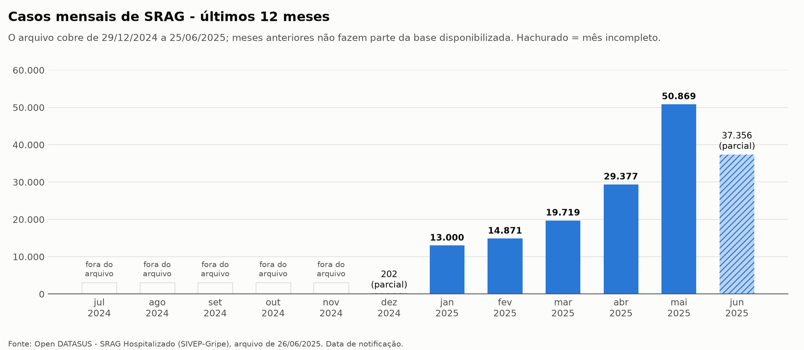

# Relatório de SRAG

Dados até **25/06/2025** · gerado em 13/11/2026 14:59 · execução `01778aaddf99`

> Relatório gerado automaticamente por um agente de IA como prova de conceito. Não substitui boletins oficiais nem avaliação de profissionais de saúde, e não contém orientação médica individual.

## Resumo executivo

Até 25/06/2025, os casos notificados nos últimos 7 dias variaram −35,9% em relação à semana anterior e +0,4% na comparação de 30 dias. A letalidade hospitalar foi de 8,5%, 26,9% dos internados com informação foram para UTI e 46,2% tinham vacina contra covid-19 comprovada.

## Métricas

| Métrica | Valor | Numerador | Denominador |
|---|---:|---:|---:|
| Taxa de aumento de casos (7 dias) | −35,9% | 6.698 | 10.448 |
| Taxa de aumento de casos (30 dias) | +0,4% | 46.845 | 46.678 |
| Taxa de mortalidade (letalidade hospitalar por SRAG) | 8,5% | 2.029 | 23.927 |
| Taxa de ocupação de UTI (proxy: % de internados que foram para UTI) | 26,9% | 10.673 | 39.608 |
| Taxa de vacinação contra covid-19 (proxy: % dos casos com vacina comprovada) | 46,2% | 21.399 | 46.264 |
## Análise

- **Taxa de aumento de casos (7 dias)**: Definição: (casos notificados nos últimos 7 dias / casos dos 7 dias anteriores) - 1. Período: 19/06/2025 a 25/06/2025 vs 12/06/2025 a 18/06/2025.
- **Taxa de aumento de casos (30 dias)**: Definição: (casos notificados nos últimos 30 dias / casos dos 30 dias anteriores) - 1. Período: 27/05/2025 a 25/06/2025 vs 27/04/2025 a 26/05/2025.
- **Taxa de mortalidade (letalidade hospitalar por SRAG)**: Definição: óbitos por SRAG / casos com evolução conhecida (cura ou óbito). Período: 27/05/2025 a 25/06/2025.
- **Taxa de ocupação de UTI (proxy: % de internados que foram para UTI)**: Definição: casos internados em UTI / casos com a informação de UTI preenchida (Sim ou Não). Período: 27/05/2025 a 25/06/2025.
- **Taxa de vacinação contra covid-19 (proxy: % dos casos com vacina comprovada)**: Definição: casos com vacina covid 'Sim' E data da 1ª dose registrada / casos com Sim ou Não informado. Período: 27/05/2025 a 25/06/2025.
## Gráficos

## Contexto das notícias

Texto padrão gerado sem LLM: as notícias abaixo foram coletadas automaticamente e não foram interpretadas.

1. [Casos graves de Covid-19 dão sinal de crescimento no Brasil, aponta Fiocruz](https://news.google.com/rss/articles/CBMirwFBVV95cUxNYkxXVDYydDF6MklRNTlnSWNqVkFHcDBqdDhDdzhBSHhUb0FpWk5WalRWOUYwVlVITm9pR3ZsVS1YVGpDbWN5M3I0UDV1ZVFYdlQwUGY3OEtSV09CZHJCajhJR2Z6UnBUQkFnVkdxLVktMEtHajFfTHA1OEVUREhhbEE0TlQzUTM3S2kzalY0WEJkT25tR2drVEhyTlZXcmJyYzlRM1JkdEVQTm9HX1BB?oc=5) - CNN Brasil, 13/11/2026
2. [Casos de Covid-19 apresentam aumento no Brasil, aponta boletim da Fiocruz](https://news.google.com/rss/articles/CBMinwFBVV95cUxQN3pabm9mWmNZQlVrS1p3SjZZUFJoMzhqczc1SWFQSFU3NEJ1cjNFclo1ZVhTR0t2eVpDY1MwMjdWNWExMlhmRlp5RmdSVllnRHBJYXM3T2xPRnVnbHh5WFJKZDVmc3ljT1V5eXVoVlRwcFJkVTh3X1JzckpwSTFWNzh2UDZieldUZGRGcGh5Y0RoejRsUzFzUXpMQTQxRlU?oc=5) - Fala Matão, 13/11/2026
3. [Fiocruz: aumentam casos de síndrome respiratória aguda por covid-19](https://news.google.com/rss/articles/CBMivgFBVV95cUxNZy1seFVIRUdYeHNfbWg3SjVleXhPZEp0MWxxeUdzV3FFRV9SSDdSOFR1Q0l6bWtvd3pneEJHbk9Wa3hwTFZ3TVB1UmVPMEw2MlVYMEEtbVVsd05EM0lGdDZLVThqTjU0V29oUkM4a3B5U1VpWkpQVjlfUkFrR0Z5a1JBdTJla1NSTU5acDRoN1lvSEkzSC01ZGU2UjF6SDJrNjBGWFZHWmprVERBYW1idFd5MWxGS1hidlkwYkp3?oc=5) - Agência Brasil, 12/11/2026
4. [Aumento de Casos de SRAG por Covid-19 no Brasil em Novembro](https://news.google.com/rss/articles/CBMijgFBVV95cUxQMDVIME9RR0NWZmZxR0llLVJRWFBtdUN1NnJYc1gxclZEN3NxOEVRRDJ3a1h4QjZtSk9wLVBsRXlMMTdfRVhzWExHd3pMdWxUTTk3Q1hvZU1PUFY5dTFqMXRaUXJKWV9BR3E0RHUzaUlzbUlNMlNIbWhsRExqLVFYcWFrSDdPOF9QdTR5QktB?oc=5) - Metrô News Jornal, 12/11/2026
5. [Acre segue fora dos grupos de alerta para SRAG enquanto Fiocruz aponta queda de casos no país](https://news.google.com/rss/articles/CBMixwFBVV95cUxPT0VkcG9taER6bUd3QmVBbnNYeWlLTzlTR2JDOTJaT3VjV2VFdWZ3TjRYWkRyWkdfeFlHcDZaUnlwZE9tanlJa2pZenVPV0t0TUlTZU8yNXdrbmd2T0pnTHhyYXpjdldaUllzMW5iRFdLc3RTRXlWc0Jhb1RkQ2lrb05Icll1TUV0MWtpa1l1aUo1ci02VDloMU56b3g5SjdXU1hQM0dDWDdka2E0b1lFc0tJM3ZudDk5cURmZnpLcnRIMHZuZnE4?oc=5) - Portal Acre, 12/11/2026
6. [Fiocruz aponta alta de casos graves de covid-19 no início de novembro](https://news.google.com/rss/articles/CBMiqgFBVV95cUxPRTltbFNGRER6eU9vUWI5Tl9DUldpREtPRWlWWDJkbUVCVkstaDBuRkdQWWJvRWU4ZTE1d0F0c3FLQWtZcVNaWHVDV2ZSaGJEZF9HaTIzQjU3bE8xcy1uYjZTZW85Ynk3bUdqdl9WVFhrMWFiZWFNajF3UjNlVXNvWm5MbHVHZDFwR3lBNHgtTU1kN2FfR0lrVVBvTThBTHhKb2pkNHBfSEdpQQ?oc=5) - TODODIA, 12/11/2026
7. [Fiocruz aponta alta de casos graves de covid-19 no Brasil](https://news.google.com/rss/articles/CBMiqgFBVV95cUxOS2xsX0hXV1lJWkdDbWhzNHJmWWNHN05UU2ozT0w3R2J0SEluWDN4cE92Q3NPT2J1bV9JVmI0N2FzR2VZZloweWs5NHI2MmhWUlZoOU84VHBzYkREX3NXcXRoQkl2cGNqREtEaDlnY3FkZEUxbGdYS3M5ckNvLUFZYlpqZm5jNUJtOFJpazcxc3FhQnc1QlpPQnBKdEdvSUVtRGxlYXlLUDIxZ9IBrwFBVV95cUxQNV93OTluV1VqMFRWb0N1T0FsRmFtQUFhbFlRbUllYjVNczBUd09iNUpRZUpYTEVnbmkzQ001ZklKYlQ1Q2VxZXpYS3JJMENLNkJvTTN2cnBKckQ0UmlpbVFLNTMwaUxjWW1LSmF4N3Y5WWlicV9OUGVLYnBVSll2alpmNGxOdHhDV25RQnAyaHJrSzUxV2RvQTh3NFlPaWZpV2NCV3lYM0xHcERKYWFj?oc=5) - Portal Piauí Hoje, 12/11/2026
8. [Casos de Covid-19 voltam a crescer no Rio, aponta Fiocruz](https://news.google.com/rss/articles/CBMimgFBVV95cUxQLW9hZ2F4VEk0LUNZbW5xVmR6V3ZjWnMwVDU0M1ltOXp4Y0k5WXVXNllTbGhhT1h3Q0FST0JLbWhCbGtJNFRSYjBTR1JEV2dpMEtLMmhqOTJXNWJLY0Q5TXQ3X015aC0tc25GSF9SS1dWR1RBMXgzWDI3UlQ3S3VlemxhZFc4eFF3eHhYcE1COXJ5YUhpM2gyVEtB?oc=5) - A Tribuna RJ, 12/11/2026
## Pontos de atenção

- Quedas nos dias mais recentes podem refletir atraso de notificação, fins de semana e feriados.
- UTI e vacinação são aproximações; consulte as definições antes de comparar com outras fontes.
## Limitações

- O arquivo disponibilizado cobre de 29/12/2024 a 26/06/2025; o gráfico de 12 meses mostra os meses anteriores como fora do arquivo.
- Ocupação de UTI é aproximada pela proporção de internados que foram para UTI: a base não informa a quantidade de leitos disponíveis.
- Vacinação é aproximada pela proporção de casos internados com vacina contra covid-19 comprovada (data da 1ª dose registrada); não é a cobertura vacinal da população.
- Mortalidade é a letalidade hospitalar: óbitos por SRAG entre casos já encerrados. Casos ainda em aberto ficam fora do cálculo.
- Os últimos dias recebem notificações com atraso; quedas recentes tendem a ser revistas para cima.
